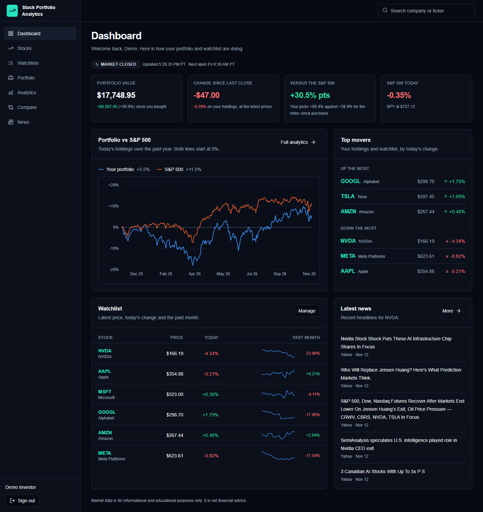
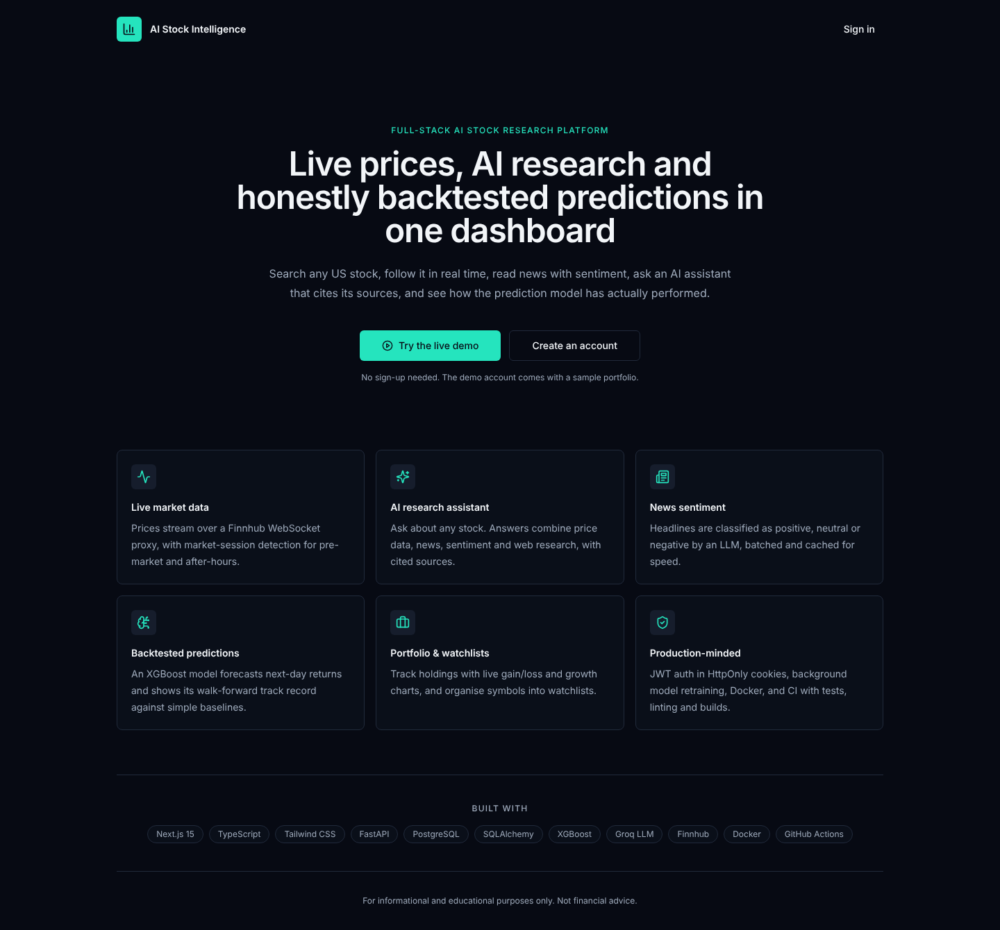
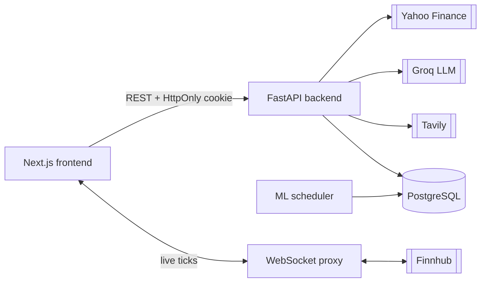

<div align="center">

# AI Stock Intelligence Platform

**Live prices, AI-powered research and honestly backtested predictions in one dashboard.**

[](https://github.com/Jugalpatel3981/ai-stock-intelligence-platform/actions/workflows/ci.yml)


[](LICENSE)

<!-- LIVE-DEMO-LINK: added after deployment -->



</div>

## Overview

A full-stack web app for researching US stocks. Search any ticker, follow it with real-time
prices, read the latest news with AI sentiment, ask an AI assistant that cites its sources,
track a portfolio, and see a next-day forecast together with the model's real track record.

> For informational and educational purposes only. Not financial advice.

## Features

| | Feature | How it works |
| --- | --- | --- |
| 📈 | **Real-time prices** | The backend proxies Finnhub's WebSocket to the browser and labels pre-market, regular and after-hours sessions. |
| 🤖 | **AI research assistant** | Answers combine price data, news, sentiment and Tavily web search. Every answer lists its sources. |
| 📰 | **News sentiment** | Headlines are classified by an LLM (Groq) in a single batched call and cached, so each article is analysed once. |
| 🧠 | **Backtested predictions** | XGBoost predicts the next-day return. Each prediction shows walk-forward accuracy against simple baselines. |
| 💼 | **Portfolio and watchlists** | Live gain/loss, a portfolio growth chart, and multiple watchlists. |
| 🔐 | **Secure accounts** | bcrypt passwords and JWT sessions in HttpOnly cookies, plus a one-click demo account. |
| ⚙️ | **Production engineering** | Background retraining, models stored in PostgreSQL, Alembic migrations, caching, rate limiting and CI. |

## Screenshots

| Stock detail | AI assistant |
| --- | --- |
|  |  |
| **Prediction with backtest** | **News and sentiment** |
|  |  |
| **Portfolio** | **Landing page** |
|  |  |

## Architecture



See [docs/ARCHITECTURE.md](docs/ARCHITECTURE.md) for the full design: auth, market data
flow, the AI assistant and the ML pipeline.

## Tech stack

| Layer | Technologies |
| --- | --- |
| Frontend | Next.js 15 (App Router), React, TypeScript, Tailwind CSS, shadcn/ui, Recharts |
| Backend | FastAPI, Python 3.12, SQLAlchemy 2 (async), Pydantic, WebSockets |
| Data and ML | PostgreSQL, pandas, NumPy, XGBoost, yfinance |
| AI | Groq (Llama 3.3 70B), Tavily search |
| Market data | Finnhub WebSocket and REST, Yahoo Finance |
| DevOps | Docker, Docker Compose, GitHub Actions |

## Prediction model: honest evaluation

Most stock-prediction demos report a "98% accuracy" that comes from scoring tomorrow's
*price*, which is almost the same as today's. This project measures what matters:

- **Target:** the next-day *return*, predicted from 19 scale-free technical features.
- **Validation:** expanding-window walk-forward, so every test prediction comes from a model
  trained only on earlier data. There is no look-ahead bias.
- **Baselines:** the naive "tomorrow = today" forecast for price error, and always guessing
  the most common direction for accuracy.
- **Strategy check:** holding only on predicted up-days, compared with buy-and-hold.

The results are in **[docs/model-performance.md](docs/model-performance.md)**. They are
generated by `python -m app.ml.backtest` or the *Model Backtest* GitHub Action. As expected
for daily returns, the edge over the baselines is small, and the app says so next to every
prediction instead of showing a made-up confidence score.

## Getting started

### Prerequisites

- [Docker Desktop](https://www.docker.com/products/docker-desktop/)
- Free API keys:

| Key | Used for | Required? |
| --- | --- | --- |
| `GROQ_API_KEY` ([console.groq.com](https://console.groq.com)) | AI assistant and news sentiment | Recommended |
| `FINNHUB_API_KEY` ([finnhub.io](https://finnhub.io)) | Real-time prices | Recommended |
| `TAVILY_API_KEY` ([tavily.com](https://tavily.com)) | Web research in the assistant | Optional |

The app still runs without keys. Those features show a clear "not configured" message.

### Run with Docker

```bash
git clone https://github.com/Jugalpatel3981/ai-stock-intelligence-platform.git
cd ai-stock-intelligence-platform
cp .env.example .env        # Windows PowerShell: Copy-Item .env.example .env
# Add your API keys to .env
docker compose up --build
```

Open **http://localhost:3000** and click **Try the live demo**.

| Service | URL |
| --- | --- |
| Frontend | http://localhost:3000 |
| API docs (Swagger) | http://localhost:8000/docs |
| Health check | http://localhost:8000/health |

<details>
<summary><b>Run without Docker</b></summary>

You need Python 3.12+, Node.js 22+ and a local PostgreSQL database.

```bash
# Backend
cd backend
python -m venv .venv
source .venv/bin/activate          # Windows: .venv\Scripts\activate
pip install -r requirements-dev.txt
cp .env.example .env               # set DATABASE_URL and your API keys
python -m app.scripts.init_db
uvicorn app.main:app --reload

# Frontend (in a second terminal, from the repository root)
npm install
npm run dev:frontend
```

</details>

## Testing

```bash
# From the backend directory
pytest                     # tests
ruff check .               # lint

# From the repository root
npm run lint:frontend      # ESLint
npm run typecheck:frontend # TypeScript
```

CI runs all of these, plus a production frontend build and Docker image builds, on every push.

## Project structure

```text
.
├── backend/
│   ├── app/
│   │   ├── api/          # FastAPI routers and dependencies
│   │   ├── core/         # Settings, database, security
│   │   ├── market/       # Finnhub streaming, market sessions, quote cache
│   │   ├── ml/           # Features, training, evaluation, registry, scheduler, backtest
│   │   ├── models/       # SQLAlchemy tables
│   │   ├── schemas/      # Pydantic models
│   │   └── services/     # Business logic and integrations
│   └── tests/
├── frontend/src/
│   ├── app/              # Next.js routes
│   ├── components/       # UI and feature components
│   └── lib/              # API client and helpers
├── docs/                 # Architecture, model performance, environment variables
└── .github/workflows/    # CI and model backtest
```

## API overview

Interactive docs are available at `/docs` when the backend is running.

| Area | Endpoints |
| --- | --- |
| Auth | `POST /auth/register`, `POST /auth/login`, `POST /auth/demo`, `GET /auth/me` |
| Stocks | `GET /stocks/search`, `GET /stocks/{ticker}`, `GET /stocks/{ticker}/history` |
| News | `GET /stocks/news?ticker=NVDA` |
| Prediction | `GET /stocks/{ticker}/prediction` |
| Market | `GET /market/quotes?symbols=NVDA,AAPL`, `WS /market/stream?symbols=NVDA,AAPL` |
| Watchlists | `GET /watchlists`, `POST /watchlists`, `POST /watchlists/{id}/stocks` |
| Portfolio | `GET /portfolio/holdings`, `GET /portfolio/growth` |
| Assistant | `GET /chat/sessions`, `POST /chat/sessions/{id}/messages` |

All paths are prefixed with `/api/v1`.

## License

[MIT](LICENSE)
