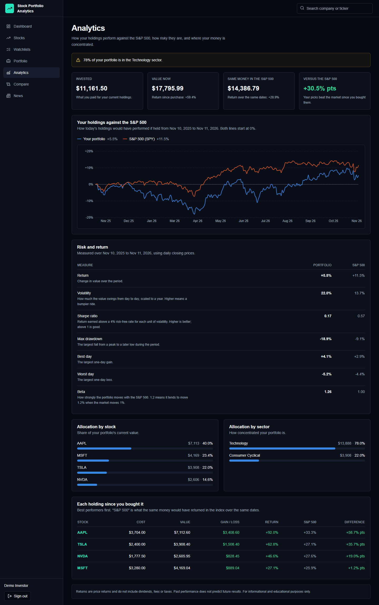
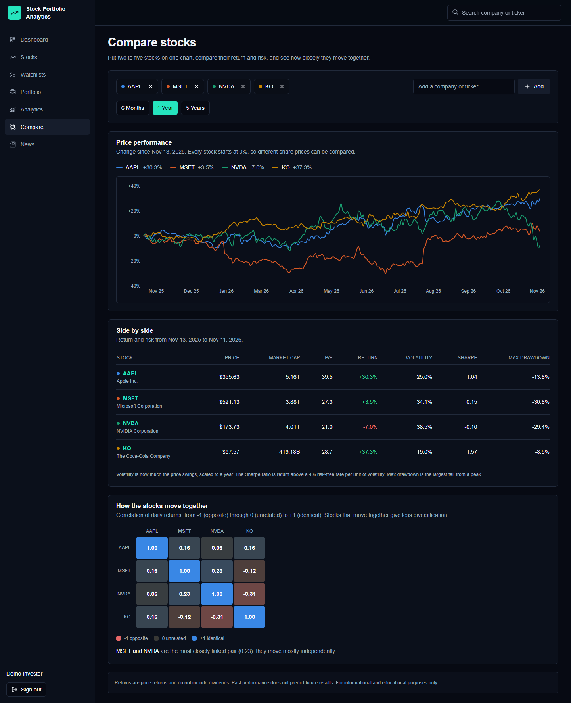
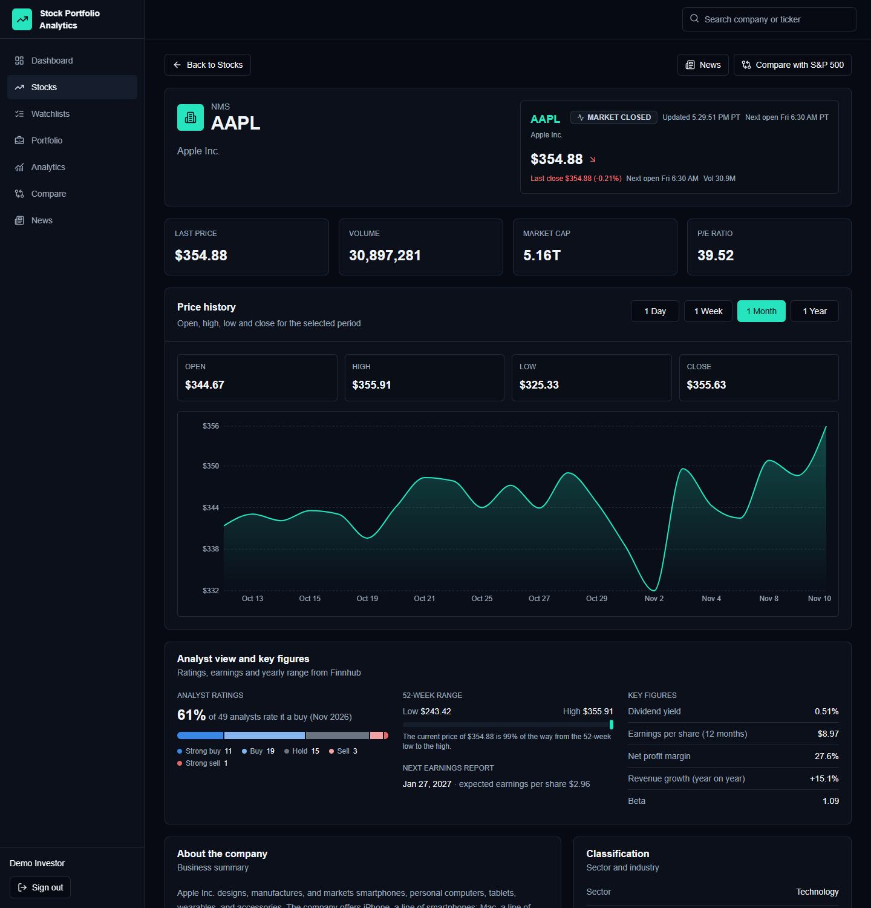
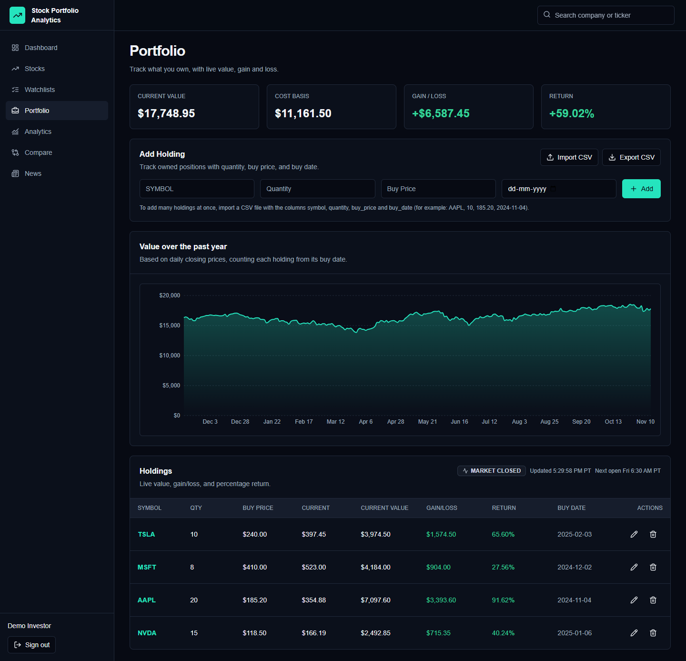
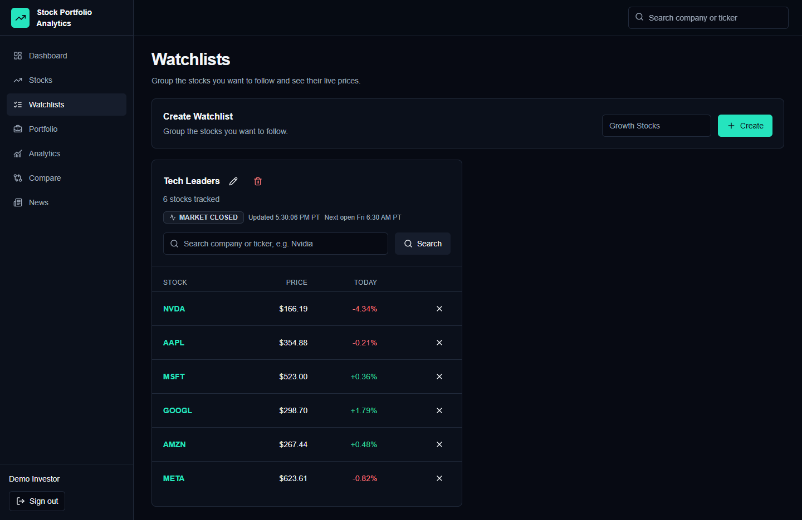
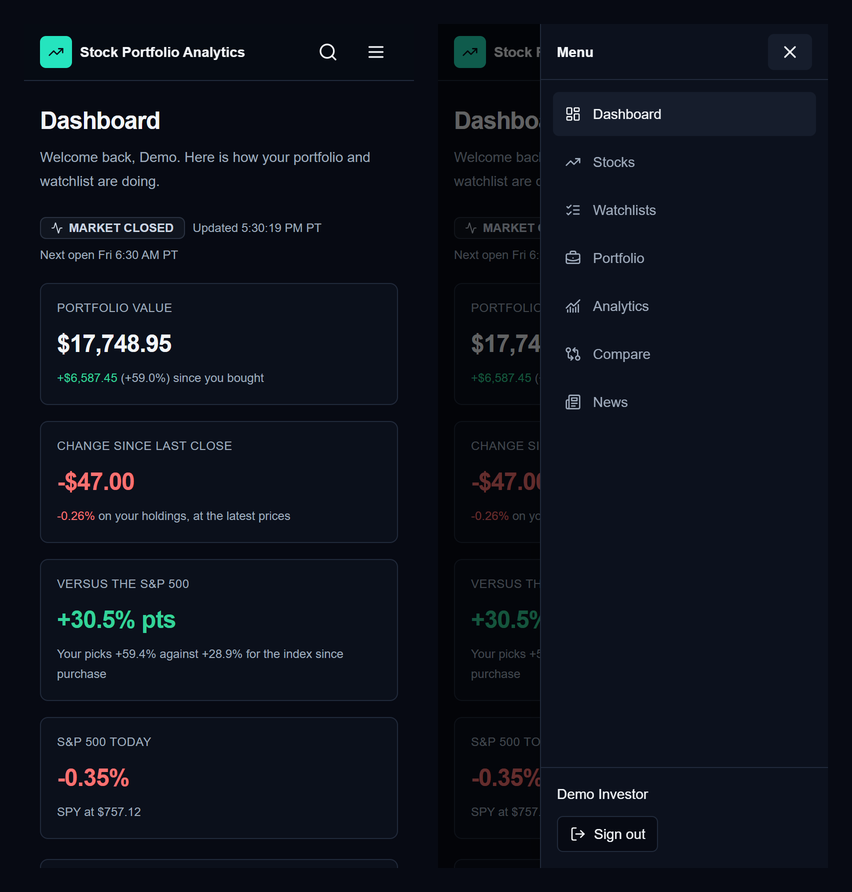
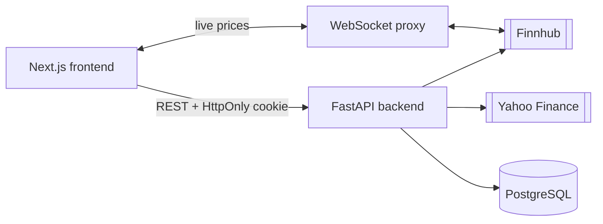

<div align="center">

# Stock Portfolio Analytics

**Track a stock portfolio against the S&P 500, with live prices and the risk figures to explain it.**

[](https://github.com/Jugalpatel3981/AI-Stock-Intelligence-Platform/actions/workflows/ci.yml)


[](LICENSE)


</div>

## What it does

A full-stack web app for following US stocks and analysing a portfolio. Add what you own,
and it shows whether your picks beat the market, how risky they are, and where your money
is concentrated.

> For informational and educational purposes only. Not financial advice.

## Features

- **Portfolio analytics:** your return against the S&P 500, plus volatility, Sharpe ratio,
  beta, max drawdown, allocation by stock and sector, and concentration warnings.
- **Stock comparison:** up to five stocks on one chart, with side-by-side risk figures and a
  correlation heatmap.
- **Live prices:** real-time quotes, including pre-market and after-hours moves.
- **Stock research:** search by company name, then see price history, analyst ratings, the
  52-week range, the next earnings date and recent news.
- **Portfolio and watchlists:** live gain and loss, a value chart, and CSV import and export.
- **Accounts:** secure sign-in, plus a one-click demo account with sample data.

## Screenshots

| Portfolio analytics | Stock comparison |
| --- | --- |
|  |  |

| Stock page | Portfolio |
| --- | --- |
|  |  |

| Watchlists | On a phone |
| --- | --- |
|  |  |

## How the analytics are calculated

All figures use daily closing prices and are price returns, without dividends.

| Measure | Calculation |
| --- | --- |
| Return against the S&P 500 | Each purchase is compared with putting the same money into SPY on the same date. |
| Volatility | Standard deviation of daily returns × √252, to give a yearly figure. |
| Sharpe ratio | (Average daily return × 252 − a 4% risk-free rate) ÷ volatility. |
| Beta | Covariance of portfolio and SPY daily returns ÷ variance of SPY daily returns. |
| Max drawdown | The largest fall from a running peak to a later low. |
| Correlation | Pearson correlation of daily returns between each pair of stocks. |

Risk figures describe today's holdings as if they had been held for the past year. The
calculations are pure functions in
[`backend/app/analytics/metrics.py`](backend/app/analytics/metrics.py), tested against
hand-checked numbers.

## Tech stack

| Layer | Technologies |
| --- | --- |
| Frontend | Next.js 15, React, TypeScript, Tailwind CSS, Recharts |
| Backend | FastAPI, Python 3.12, SQLAlchemy (async), Pydantic, WebSockets |
| Data and analysis | PostgreSQL, pandas, NumPy |
| Market data | Finnhub (live prices, search, news, analyst data), Yahoo Finance (price history, company profiles) |
| Tooling | Docker Compose, Alembic migrations, pytest, GitHub Actions |



More detail is in [docs/ARCHITECTURE.md](docs/ARCHITECTURE.md).

## Run it

You need [Docker Desktop](https://www.docker.com/products/docker-desktop/) and a free
[Finnhub](https://finnhub.io) API key.

```bash
git clone https://github.com/Jugalpatel3981/AI-Stock-Intelligence-Platform.git
cd AI-Stock-Intelligence-Platform
cp .env.example .env        # Windows PowerShell: Copy-Item .env.example .env
# Open .env and set FINNHUB_API_KEY
docker compose up --build
```

Open **http://localhost:3000** and click **Try the live demo**. The API documentation is at
http://localhost:8000/docs.

The backend takes a minute or two to start the first time. Until it is ready, the site shows
"Waiting for the server" and retries by itself.

Without a Finnhub key the app still runs, but live prices, news and analyst data are
unavailable, and search only finds exact ticker symbols.

<details>
<summary><b>Run without Docker</b></summary>

You need Python 3.12+, Node.js 22+ and a local PostgreSQL database.

```bash
# Backend
cd backend
python -m venv .venv
source .venv/bin/activate          # Windows: .venv\Scripts\activate
pip install -r requirements-dev.txt
cp .env.example .env               # set DATABASE_URL and FINNHUB_API_KEY
python -m app.scripts.init_db
uvicorn app.main:app --reload

# Frontend (in a second terminal, from the repository root)
npm install
npm run dev:frontend
```

</details>

## Tests

```bash
# From the backend directory
pytest          # 132 tests
ruff check .    # lint

# From the repository root
npm run lint:frontend
npm run typecheck:frontend
```

GitHub Actions runs these on every push, along with the database migrations, a production
frontend build and both Docker image builds.

## Project structure

```text
backend/app/
├── analytics/    # Risk and return calculations
├── api/          # API routes
├── market/       # Live price streaming and market sessions
├── models/       # Database tables
├── schemas/      # Request and response shapes
└── services/     # Stocks, news, portfolio, analytics, watchlists
frontend/src/
├── app/          # Pages
├── components/   # UI and feature components
└── lib/          # API client and helpers
docs/             # Architecture, deployment, environment variables
```

## Documentation

- [Architecture](docs/ARCHITECTURE.md)
- [Environment variables](docs/environment-variables.md)
- [Deployment on free hosting](docs/deployment.md)
- [Changelog](CHANGELOG.md)

## License

[MIT](LICENSE)
