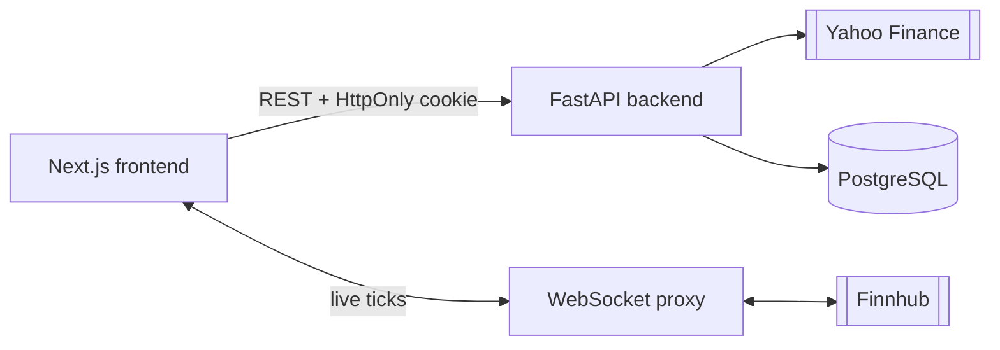

<div align="center">

# Stock Intelligence Platform

**Live prices, stock research and portfolio tracking in one dashboard.**

[](https://github.com/Jugalpatel3981/ai-stock-intelligence-platform/actions/workflows/ci.yml)


[](LICENSE)

<!-- LIVE-DEMO-LINK: added after deployment -->


</div>

## Overview

A full-stack web app for researching US stocks. Search a ticker, follow it with real-time
prices, view its price history and company profile, read recent headlines, organise
watchlists and track a portfolio.

> For informational and educational purposes only. Not financial advice.

## Features

| | Feature | How it works |
| --- | --- | --- |
| 📈 | **Real-time prices** | The backend proxies Finnhub's WebSocket to the browser and labels pre-market, regular and after-hours sessions. |
| 💼 | **Portfolio and watchlists** | Live gain/loss, a portfolio growth chart, and multiple watchlists. |
| 🔐 | **Secure accounts** | bcrypt passwords and JWT sessions in HttpOnly cookies, plus a one-click demo account. |
| 🔎 | **Stock research** | Company profile, key statistics and price history over one day to one year. |
| 📰 | **News** | Recent headlines filtered by ticker. |
| ⚙️ | **Production engineering** | Alembic migrations, caching, rate limiting, Docker and CI. |

## Architecture



See [docs/ARCHITECTURE.md](docs/ARCHITECTURE.md) for the full design: auth and the market
data flow.

## Tech stack

| Layer | Technologies |
| --- | --- |
| Frontend | Next.js 15 (App Router), React, TypeScript, Tailwind CSS, shadcn/ui, Recharts |
| Backend | FastAPI, Python 3.12, SQLAlchemy 2 (async), Pydantic, WebSockets |
| Data | PostgreSQL, yfinance |
| Market data | Finnhub WebSocket and REST, Yahoo Finance |
| DevOps | Docker, Docker Compose, Alembic, GitHub Actions, Render, Vercel, Neon |

## Getting started

### Prerequisites

- [Docker Desktop](https://www.docker.com/products/docker-desktop/)
- A free API key:

| Key | Used for | Required? |
| --- | --- | --- |
| `FINNHUB_API_KEY` ([finnhub.io](https://finnhub.io)) | Real-time prices | Recommended |

The app still runs without the key. Live prices then show a clear "not configured" message.

### Run with Docker

```bash
git clone https://github.com/Jugalpatel3981/ai-stock-intelligence-platform.git
cd ai-stock-intelligence-platform
cp .env.example .env        # Windows PowerShell: Copy-Item .env.example .env
# Add your Finnhub API key to .env
docker compose up --build
```

Open **http://localhost:3000** and click **Try the live demo**.

| Service | URL |
| --- | --- |
| Frontend | http://localhost:3000 |
| API docs (Swagger) | http://localhost:8000/docs |
| Health check | http://localhost:8000/health |

### Deploy

[docs/deployment.md](docs/deployment.md) describes a free-tier setup on Vercel, Render and Neon.

<details>
<summary><b>Run without Docker</b></summary>

You need Python 3.12+, Node.js 22+ and a local PostgreSQL database.

```bash
# Backend
cd backend
python -m venv .venv
source .venv/bin/activate          # Windows: .venv\Scripts\activate
pip install -r requirements-dev.txt
cp .env.example .env               # set DATABASE_URL and your Finnhub key
python -m app.scripts.init_db
uvicorn app.main:app --reload

# Frontend (in a second terminal, from the repository root)
npm install
npm run dev:frontend
```

</details>

## Testing

```bash
# From the backend directory
pytest                     # tests
ruff check .               # lint

# From the repository root
npm run lint:frontend      # ESLint
npm run typecheck:frontend # TypeScript
```

CI runs all of these, plus a production frontend build and Docker image builds, on every push.

## Project structure

```text
.
├── backend/
│   ├── app/
│   │   ├── api/          # FastAPI routers and dependencies
│   │   ├── core/         # Settings, database, security
│   │   ├── market/       # Finnhub streaming, market sessions, quote cache
│   │   ├── models/       # SQLAlchemy tables
│   │   ├── schemas/      # Pydantic models
│   │   └── services/     # Business logic and integrations
│   └── tests/
├── frontend/src/
│   ├── app/              # Next.js routes
│   ├── components/       # UI and feature components
│   └── lib/              # API client and helpers
├── docs/                 # Architecture, deployment, environment variables
└── .github/workflows/    # CI
```

## API overview

Interactive docs are available at `/docs` when the backend is running.

| Area | Endpoints |
| --- | --- |
| Auth | `POST /auth/register`, `POST /auth/login`, `POST /auth/demo`, `GET /auth/me` |
| Stocks | `GET /stocks/search`, `GET /stocks/{ticker}`, `GET /stocks/{ticker}/history` |
| News | `GET /stocks/news?ticker=NVDA` |
| Market | `GET /market/quotes?symbols=NVDA,AAPL`, `WS /market/stream?symbols=NVDA,AAPL` |
| Watchlists | `GET /watchlists`, `POST /watchlists`, `POST /watchlists/{id}/stocks` |
| Portfolio | `GET /portfolio/holdings`, `GET /portfolio/growth` |

All paths are prefixed with `/api/v1`.

## License

[MIT](LICENSE)
