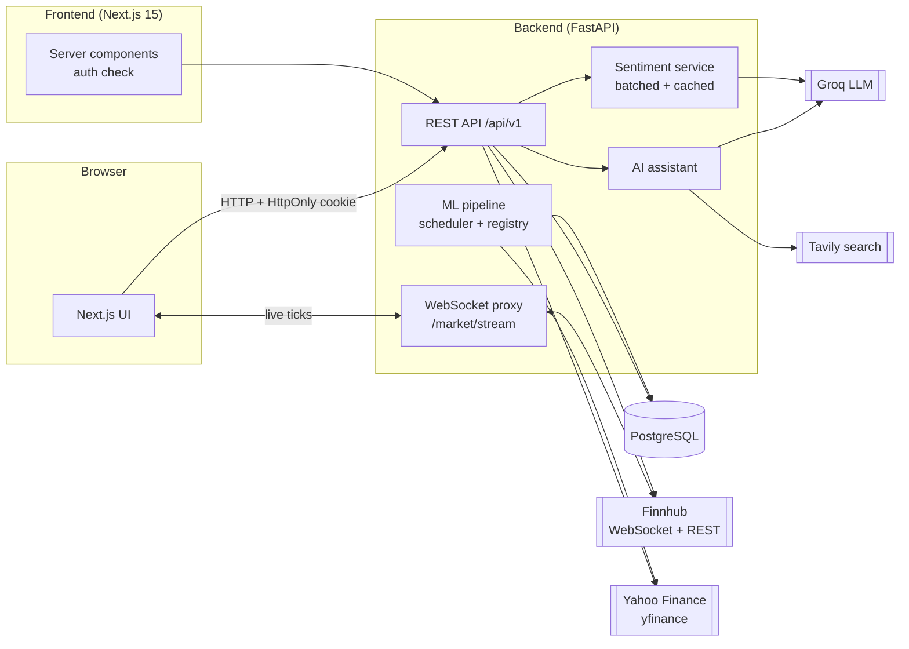

# Architecture

AI Stock Intelligence Platform is a monorepo with a Next.js frontend, a FastAPI backend and a
PostgreSQL database. The backend also runs two background jobs: model retraining and a market
data cache.



## Backend layout

```text
backend/app/
├── api/        # Routers (auth, stocks, market, watchlists, portfolio, chat) and dependencies
├── core/       # Settings, database engine, password hashing and JWT
├── market/     # Finnhub WebSocket/REST clients, market-session rules, quote cache
├── ml/         # Feature engineering, training, evaluation, registry, scheduler, backtest
├── models/     # SQLAlchemy tables
├── schemas/    # Pydantic request/response models
└── services/   # Business logic: stocks, news, sentiment, chat, portfolio, watchlists, demo
```

Routes stay thin and call services, so business logic can be tested without HTTP.

The schema is managed with **Alembic** (`backend/migrations/`). The container applies pending
migrations on start with `python -m app.scripts.init_db`, and CI checks that the models and
migrations match.

Yahoo Finance responses are cached in memory for 30 seconds to an hour depending on the data,
and login, registration, demo login and assistant messages are rate-limited per client IP.

## Authentication

- Passwords are hashed with bcrypt. Login issues a JWT stored in an **HttpOnly cookie**, so
  JavaScript never sees the token.
- Protected routes use the `get_current_user` dependency. The WebSocket stream checks the same
  cookie before connecting to Finnhub.
- In production the app refuses to start with a placeholder JWT secret or insecure cookies.
- `POST /auth/demo` signs visitors into a shared demo account seeded with a sample watchlist
  and portfolio. Disable it with `DEMO_MODE_ENABLED=false`.

## Market data

Fast and slow data come from different sources so neither overwrites the other:

| Data | Source | Refresh |
| --- | --- | --- |
| Last price, change | Finnhub WebSocket, proxied by the backend | Every trade |
| Open, high, low, volume, previous close | Finnhub REST, with Yahoo fallback | 30-second cache |
| Company profile, history, news | Yahoo Finance via `yfinance` | Per request |

`market/market_session.py` detects US pre-market, regular, after-hours and closed sessions in
`America/New_York` time, so the UI can label prices correctly.

## News sentiment

All headlines for a request are sent to Groq in **one** call using JSON mode. Each is labelled
Positive, Neutral or Negative with a confidence score. Results are cached by text, so an
article is only classified once. Without a `GROQ_API_KEY`, every article falls back to Neutral.

## AI assistant

1. Tickers are extracted from the question (`$NVDA`, `NVDA`, or company names such as "Apple").
   Follow-up questions reuse tickers from earlier in the conversation.
2. The backend gathers context: company data, recent news with sentiment, web research from
   Tavily, and, for prediction questions, the model's forecast and backtest record.
3. Groq (or OpenAI) answers using only that context, and the cited sources are stored with
   the message.

## ML pipeline

| Step | Module | Details |
| --- | --- | --- |
| Collect | `data_collector.py` | 5 years of daily prices into `historical_prices` |
| Features | `feature_engineering.py` | 19 scale-free features: returns, moving-average gaps, MACD, RSI, Bollinger, volume ratios, volatility |
| Train | `trainer.py` | XGBoost regressor on the next-day return |
| Evaluate | `evaluator.py` | Walk-forward validation against a "no change" forecast and the majority direction |
| Register | `registry.py` | Stores the serialized model in PostgreSQL (so it survives restarts on hosts with temporary disks) and promotes it unless its skill score is clearly worse |
| Schedule | `scheduler.py` | Retrains watchlist, portfolio and default symbols when their model is older than `ML_RETRAIN_INTERVAL_DAYS`; unseen tickers are queued on demand |
| Report | `backtest.py` | Generates [`model-performance.md`](model-performance.md) |

Predictions are never trained inside a request. A ticker without a model returns a `preparing`
status and is queued for background training.

**Walk-forward validation:** the most recent 40% of days is split into 5 consecutive folds.
Each fold is predicted by a model trained only on the days before it, which prevents
look-ahead bias.

## Testing and CI

GitHub Actions runs on every push and pull request:

- **Backend:** ruff lint, ruff format check, pytest
- **Migrations:** applied to a real PostgreSQL, then `alembic check`
- **Frontend:** ESLint, TypeScript type-check, production build
- **Docker:** builds both images

A separate, manually triggered workflow runs the model backtest on fresh data and commits the
report.
