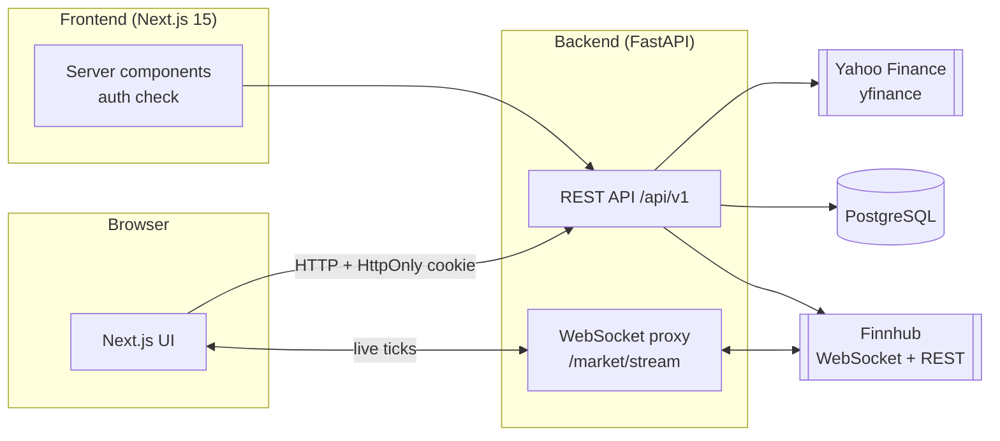

# Architecture

Stock Portfolio Analytics is a monorepo with a Next.js frontend, a FastAPI backend and a
PostgreSQL database. The backend also keeps a short-lived cache of market data.



## Backend layout

```text
backend/app/
├── analytics/  # Pure risk and return calculations (volatility, Sharpe, beta, drawdown)
├── api/        # Routers (auth, stocks, market, watchlists, portfolio) and dependencies
├── core/       # Settings, database engine, password hashing and JWT
├── market/     # Finnhub WebSocket/REST clients, market-session rules, quote cache
├── models/     # SQLAlchemy tables
├── schemas/    # Pydantic request/response models
└── services/   # Business logic: stocks, news, portfolio, analytics, insights, watchlists, demo
```

Routes stay thin and call services, so business logic can be tested without HTTP.

The schema is managed with **Alembic** (`backend/migrations/`). The container applies pending
migrations on start with `python -m app.scripts.init_db`, and CI checks that the models and
migrations match.

Yahoo Finance responses are cached in memory for 30 seconds to an hour depending on the data,
and login, registration and demo login are rate-limited per client IP.

## Authentication

- Passwords are hashed with bcrypt. Login issues a JWT stored in an **HttpOnly cookie**, so
  JavaScript never sees the token.
- Protected routes use the `get_current_user` dependency. The WebSocket stream checks the same
  cookie before connecting to Finnhub.
- In production the app refuses to start with a placeholder JWT secret or insecure cookies.
- `POST /auth/demo` signs visitors into a shared demo account seeded with a sample watchlist
  and portfolio. Disable it with `DEMO_MODE_ENABLED=false`.

## Market data

Fast and slow data come from different sources so neither overwrites the other:

| Data | Source | Refresh |
| --- | --- | --- |
| Last price, change | Finnhub WebSocket, proxied by the backend | Every trade |
| Open, high, low, previous close | Finnhub REST | 30-second cache |
| Volume | Yahoo Finance | 30-second cache |
| Company profile, price history | Yahoo Finance via `yfinance` | Cached 1 to 15 minutes |
| Stock search, company news | Finnhub REST | Cached 10 to 60 minutes |
| Pre-market and after-hours price | Yahoo Finance, when Finnhub has no extended-hours trade | 30-second cache |

`market/market_session.py` detects US pre-market, regular, after-hours and closed sessions in
`America/New_York` time, so the UI can label prices correctly. Outside regular hours the
change is measured against the regular session price, not the previous day's close.

Tickers are checked before they are saved to a watchlist or portfolio: Finnhub answers for
US stocks and ETFs, and anything it does not price is checked against Yahoo Finance.
Unknown tickers are remembered for ten minutes so repeat lookups fail fast.

## Portfolio analytics and comparison

| Step | Where | Details |
| --- | --- | --- |
| Prices | `stock_service.get_daily_closes` | Up to five years of daily closes per ticker from Yahoo Finance, cached for 30 minutes |
| Maths | `analytics/metrics.py` | Pure functions on pandas series: returns, volatility, Sharpe ratio, beta, max drawdown, correlation |
| Portfolio | `analytics_service.get_portfolio_analytics` | Aligns holdings and SPY on shared trading days, then reports risk, allocation and each holding against the benchmark |
| Compare | `analytics_service.compare_stocks` | Rebases two to five tickers to 100 and returns their statistics and correlation matrix |

Two questions are answered separately, because they need different data:

- **Since purchase:** each lot is compared with putting the same money into SPY on its buy
  date. This uses the buy price and date the user entered.
- **Risk over the past year:** today's holdings are valued on every trading day of the last
  year, as if held throughout, so volatility and drawdown are not distorted by deposits.

Holdings without price history are left out and named in a warning, rather than failing the
whole page. CSV import follows the same rule: good rows are saved and each bad row is
reported with its row number.

## Testing and CI

GitHub Actions runs on every push and pull request:

- **Backend:** ruff lint, ruff format check, pytest
- **Migrations:** applied to a real PostgreSQL, then `alembic check`
- **Frontend:** ESLint, TypeScript type-check, production build
- **Docker:** builds both images
